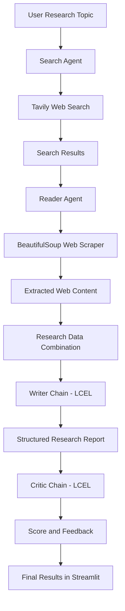

# 🔍 Multi-Agent Research System

An AI-powered research application that automates web research, webpage extraction, report generation, and quality evaluation using multiple AI agents and LangChain.

The system takes a research topic as input and coordinates specialized agents to gather information from the web, extract detailed content from relevant sources, generate a structured research report, and evaluate the final output.

## 🚀 Live Demo

**GitHub Repository:** [Multi-Agent-System](https://github.com/suminyol/Multi-Agent-System)

**Live Application:** [Try the Streamlit App](https://share.streamlit.io/)

## ✨ Features

- **AI-Powered Web Search:** Uses Tavily to discover relevant and recent information from the web.
- **Intelligent Web Scraping:** Uses BeautifulSoup to extract readable content from selected webpages.
- **Multi-Agent Architecture:** Separates research and content extraction into specialized agents.
- **ReAct Agent Workflow:** Uses LangChain's agent framework for reasoning and tool execution.
- **Automated Report Generation:** Generates structured research reports using an LLM.
- **AI-Based Critic:** Reviews the generated report, assigns a score, and identifies areas for improvement.
- **LCEL Pipelines:** Uses LangChain Expression Language (LCEL) to compose prompts, language models, and output parsers.
- **Interactive Interface:** Provides a Streamlit-based interface for submitting research topics and viewing results.

## 🏗️ System Architecture

The application follows a sequential multi-agent research workflow.



### 1. Search Agent

The Search Agent uses LangChain's `create_agent` with the Gemini language model and Tavily search tool.

Responsibilities:
- Understand the research topic.
- Search for relevant and recent information.
- Identify useful sources.
- Return titles, URLs, and content snippets.

### 2. Reader Agent

The Reader Agent uses a webpage scraping tool built with Requests and BeautifulSoup.

Responsibilities:
- Select relevant URLs from search results.
- Fetch webpage HTML.
- Remove unnecessary elements such as scripts, styles, navigation, and footer sections.
- Extract clean textual content for deeper research.

### 3. Writer Chain

The Writer Chain uses LCEL to combine a prompt template, language model, and string output parser.

```python
writer_chain = writer_prompt | llm | StrOutputParser()
```

It generates a structured report containing:

- Introduction
- Key Findings
- Conclusion
- Sources

### 4. Critic Chain

The Critic Chain evaluates the generated report using another LCEL pipeline.

```python
critic_chain = critic_prompt | llm | StrOutputParser()
```

It provides:

- Overall score out of 10
- Strengths
- Areas to improve
- Final verdict

## 🛠️ Tech Stack

| Technology | Purpose |
|---|---|
| Python | Core programming language |
| LangChain | Agent development and orchestration |
| LangGraph | Agent execution framework |
| LCEL | Runnable-based chain composition |
| Google Gemini | Language model |
| Tavily | Web search |
| BeautifulSoup | Webpage content extraction |
| Requests | HTTP requests |
| Streamlit | Interactive frontend |
| Pydantic | Data validation |
| Python-dotenv | Environment variable management |

## 📁 Project Structure

```text
Multi-Agent-System/
│
├── app.py              # Streamlit application
├── agents.py           # Agent and LCEL chain definitions
├── tools.py            # Tavily search and scraping tools
├── pipeline.py         # Complete research workflow
├── requirements.txt    # Project dependencies
├── .gitignore          # Git ignored files
└── README.md           # Project documentation
```

## ⚙️ Installation and Setup

### Prerequisites

- Python installed on your system.
- Git.
- Google Gemini API key.
- Tavily API key.

### 1. Clone the repository

```bash
git clone https://github.com/suminyol/Multi-Agent-System.git

cd Multi-Agent-System
```

### 2. Create a virtual environment

```bash
python -m venv .venv
```

Activate it:

**Windows:**

```bash
.venv\Scripts\activate
```

**Linux/macOS:**

```bash
source .venv/bin/activate
```

### 3. Install dependencies

```bash
pip install -r requirements.txt
```

### 4. Configure environment variables

Create a `.env` file in the project root:

```env
GOOGLE_API_KEY=your_google_api_key
TAVILY_API_KEY=your_tavily_api_key
```

The current agent configuration uses Google Gemini. Mistral integration is included in the dependencies but is not currently used by the visible agent initialization.

**Important:** Never commit your `.env` file or expose API keys publicly.

### 5. Run the application

```bash
streamlit run app.py
```

Open the local URL displayed in your terminal, usually:

```text
http://localhost:8501
```

## ☁️ Deployment

The application can be deployed using Streamlit Community Cloud.

1. Push your project to GitHub.
2. Visit [Streamlit Community Cloud](https://share.streamlit.io/).
3. Sign in with GitHub.
4. Select your repository.
5. Set the main application file to `app.py`.
6. Add your API keys under the application's Secrets settings.

Configure the secrets in TOML format:

```toml
GOOGLE_API_KEY = "your_google_api_key"
TAVILY_API_KEY = "your_tavily_api_key"
```

7. Deploy the application.

## 🔑 Environment Variables

| Variable | Description |
|---|---|
| `GOOGLE_API_KEY` | Authentication for Google Gemini |
| `TAVILY_API_KEY` | Authentication for Tavily Search |

Keep these credentials private and use Streamlit Secrets for cloud deployment.

## 🔄 Research Workflow

When a user submits a research topic:

1. The Search Agent receives the topic and performs web searches using Tavily.
2. Search results are collected, including relevant URLs and snippets.
3. The Reader Agent selects a relevant URL and extracts detailed webpage content.
4. Search results and scraped content are combined into a research context.
5. The Writer Chain generates a structured research report.
6. The Critic Chain evaluates the report and provides a score and feedback.
7. The application displays the research report and critic evaluation.

## 📌 Future Improvements

- Introduce additional specialized research agents.
- Implement parallel agent execution using `RunnableParallel`.
- Add iterative report refinement based on critic feedback.
- Support multiple research sources and cross-source verification.
- Add citation validation and source reliability scoring.
- Implement conversation memory for follow-up research.
- Export generated reports as PDF and DOCX.
- Add configurable research depth and number of sources.

## 🎯 Learning Outcomes

This project demonstrates practical implementation of:

- Multi-agent AI systems.
- Tool calling and ReAct-style agents.
- LangChain and LangGraph.
- LCEL and Runnable pipelines.
- Prompt engineering.
- Web search and webpage scraping.
- LLM-based report generation and evaluation.
- Streamlit application development and deployment.

## 👨‍💻 Author

**Suminder**

GitHub: [@suminyol](https://github.com/suminyol)

---

⭐ If you find this project useful, consider giving the repository a star!
